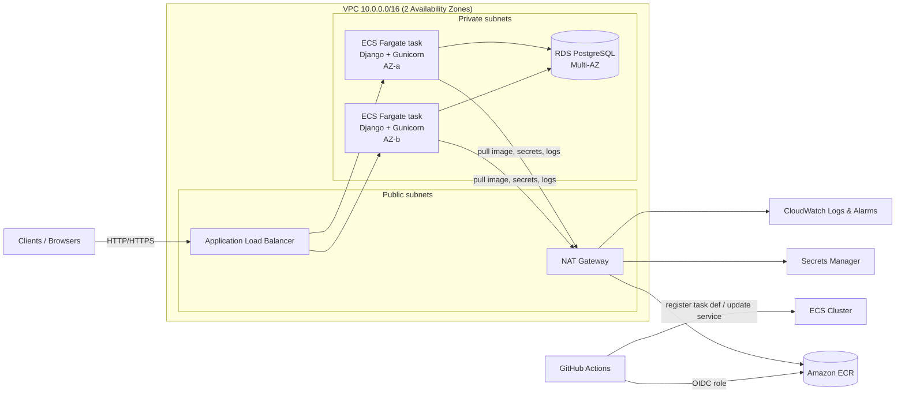
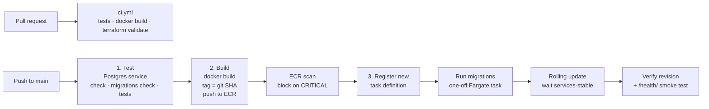

# Django on AWS ECS Fargate: Containerized, Auto-Scaling, Zero-Downtime CI/CD

Automated deployment of a Django media-analytics dashboard to **AWS ECS (Fargate)** using **Amazon ECR**, **Terraform** and **GitHub Actions**.

---

## 1. The problem and the solution

| Problem (before) | Solution (after) |
|---|---|
| Single EC2 instance crashes when traffic spikes | ECS Fargate service running **2–10 tasks across 2 AZs**, with **auto scaling** on CPU and requests-per-task behind an **Application Load Balancer** |
| Manual SSH deployments cause downtime | **Rolling deployments** (min 100% / max 200%) with ALB health checks, connection draining and an automatic **circuit-breaker rollback** |
| Inconsistent environments | One **Docker image** built once and promoted; the same image runs locally, in CI and in production. Config comes from environment variables and Secrets Manager |
| Developers push straight to the server, no CI/CD | **GitHub Actions**: PR checks → test → build → scan → push to ECR → migrate → deploy. Nobody needs server access |
| Infrastructure built by hand | Everything is defined in **Terraform**, so it's reviewable, repeatable and easy to recreate |

---

## 2. AWS architecture overview



Plain-text version:

```
Internet
   │
   ▼
[ ALB : 80/443 ]  (public subnets, AZ-a + AZ-b)
   │  health check: GET /health/
   ▼
[ ECS Fargate tasks : 8000 ]  (private subnets, 2..10 tasks, auto scaling)
   │                     │
   ▼                     ▼ (via NAT)
[ RDS PostgreSQL ]   ECR · Secrets Manager · CloudWatch
 (private, Multi-AZ)
```

### Components

| Component | Purpose | Terraform file |
|---|---|---|
| VPC, 2 public + 2 private subnets, IGW, NAT | Network isolation across 2 AZs | `vpc.tf` |
| Security groups | ALB ← internet, ECS ← ALB only, RDS ← ECS only | `security_groups.tf` |
| ECR repository | Private image registry, immutable tags, scan on push, keeps last 30 images | `ecr.tf` |
| Application Load Balancer | Spreads traffic across tasks, health checks, TLS termination, connection draining | `alb.tf` |
| ECS cluster, task definition, service | Runs the containers on Fargate (no servers to manage) | `ecs.tf` |
| Application Auto Scaling | Target tracking: 60% CPU and 500 requests/task/min | `autoscaling.tf` |
| RDS PostgreSQL | Managed database, encrypted, Multi-AZ, 7-day backups | `rds.tf` |
| Secrets Manager | Django `SECRET_KEY` and the RDS-managed DB password, injected at runtime | `secrets.tf`, `rds.tf` |
| IAM roles | Task execution role, task role, GitHub Actions OIDC deploy role (least privilege) | `iam.tf`, `github_oidc.tf` |
| CloudWatch | Container logs, Container Insights, alarms for 5xx, no healthy tasks, high CPU | `ecs.tf`, `monitoring.tf` |

### How each original problem is solved

- **Traffic spikes:** the ALB spreads requests across several tasks. When CPU goes above 60% or requests per task go above 500/min, auto scaling adds tasks (up to 10). If one task crashes, the ALB stops sending it traffic and ECS replaces it automatically.
- **Zero downtime:** during a deploy ECS starts the new tasks *next to* the old ones (`maximum_percent = 200`). New tasks only get traffic after they pass `/health/`. Old tasks are drained for 30s so in-flight requests can finish, then stopped. Healthy capacity never drops below 100%. If the new version fails its health checks, the **circuit breaker** rolls back to the last working version.
- **Consistency:** the image is built once per commit and tagged with the git SHA. The same image is used everywhere, so "what's in prod" always maps to exactly one commit.

---

## 3. Repository structure

```
django-ecs-deploy/
├── app/                          # Django application
│   ├── config/                   # settings (env-var driven), urls, wsgi
│   ├── dashboard/                # models, views, /health/, middleware, tests
│   ├── Dockerfile                # multi-stage, non-root, healthcheck
│   ├── gunicorn.conf.py          # graceful shutdown + keepalive tuned for ALB
│   └── requirements.txt
├── terraform/                    # all AWS infrastructure
│   ├── versions.tf  variables.tf  outputs.tf  terraform.tfvars.example
│   ├── vpc.tf  security_groups.tf  alb.tf
│   ├── ecr.tf  ecs.tf  autoscaling.tf
│   ├── rds.tf  secrets.tf  iam.tf  github_oidc.tf
│   └── monitoring.tf
├── .github/workflows/
│   ├── ci.yml                    # pull requests: tests, docker build, terraform validate
│   ├── deploy.yml                # main branch: test → build → scan → migrate → deploy
│   └── rollback.yml              # manual rollback to a previous task definition revision
└── docker-compose.yml            # local dev with PostgreSQL
```

---

## 4. Setup instructions

### Prerequisites

- AWS account and the AWS CLI v2, logged in (`aws sts get-caller-identity` works)
- Terraform >= 1.11
- Docker
- A GitHub repository containing this code

### Step 0: Run it locally (optional)

```bash
docker compose up --build
# open http://localhost:8000   and   http://localhost:8000/health/
docker compose exec web python manage.py createsuperuser   # then visit /admin/
```

Run the tests without Docker:

```bash
cd app
pip install -r requirements.txt
python manage.py test
```

### Step 1: Remote state bucket (one time)

```bash
ACCOUNT_ID=$(aws sts get-caller-identity --query Account --output text)
aws s3api create-bucket --bucket media-analytics-tfstate-$ACCOUNT_ID --region us-east-1
aws s3api put-bucket-versioning --bucket media-analytics-tfstate-$ACCOUNT_ID \
  --versioning-configuration Status=Enabled
```

Then uncomment the `backend "s3"` block in `terraform/versions.tf` and set the bucket name.

### Step 2: Configure variables

```bash
cd terraform
cp terraform.tfvars.example terraform.tfvars
# edit github_repo = "your-user/your-repo"  (required)
```

### Step 3: Create the ECR repository first

The ECS service needs an image to start, so create ECR first and push an initial image.

```bash
terraform init
terraform apply -target=aws_ecr_repository.app
```

### Step 4: Build and push the initial image

```bash
REGION=us-east-1
REPO_URL=$(terraform output -raw ecr_repository_url)

aws ecr get-login-password --region $REGION \
  | docker login --username AWS --password-stdin ${REPO_URL%%/*}

docker build -t $REPO_URL:initial ../app
docker push $REPO_URL:initial
```

> Apple Silicon (M1/M2/M3) users: build with `docker build --platform linux/amd64 ...` because the task runs on X86_64.

### Step 5: Create the rest of the infrastructure

```bash
terraform plan -out=tfplan
terraform apply tfplan      # ~10-15 minutes (RDS takes the longest)
terraform output
```

Open the `app_url` output. `/health/` should return `{"status": "ok"}`.

### Step 6: Connect GitHub Actions

In GitHub → **Settings → Secrets and variables → Actions → Variables**, add:

| Variable | Value (from `terraform output`) |
|---|---|
| `AWS_REGION` | e.g. `us-east-1` |
| `AWS_ROLE_ARN` | `github_actions_role_arn` |
| `ECR_REPOSITORY` | `ecr_repository_name` |
| `ECS_CLUSTER` | `ecs_cluster_name` |
| `ECS_SERVICE` | `ecs_service_name` |
| `ECS_TASK_FAMILY` | `ecs_task_family` |
| `APP_URL` | `app_url` (used for the smoke test) |

No AWS access keys are needed. GitHub authenticates to AWS with **OIDC**.

Optional: under **Settings → Environments**, create `production` and add required reviewers for a manual approval step before every deploy.

### Step 7: Deploy

Automatic deploys ship turned off so the pipeline doesn't fail before AWS exists. In `.github/workflows/deploy.yml`, uncomment the `push:` trigger, then:

```bash
git push origin main
```

(Or run it any time from **Actions → Deploy to AWS ECS → Run workflow**.)

Watch the **Actions** tab. The dashboard footer and `/health/` show the commit SHA that is live.

### Create an admin user in production (ECS Exec, no SSH)

```bash
TASK=$(aws ecs list-tasks --cluster <cluster> --service-name <service> --query 'taskArns[0]' --output text)
aws ecs execute-command --cluster <cluster> --task $TASK --container web \
  --interactive --command "python manage.py createsuperuser"
```

(Requires the Session Manager plugin for the AWS CLI.)

---

## 5. GitHub Actions pipeline workflow



### `ci.yml` (every pull request)
1. Django `check`, migration check, unit tests
2. Docker image build (proves the Dockerfile still works)
3. `terraform fmt -check`, `init -backend=false`, `validate`

### `deploy.yml` (every push to `main`)

| Job | Steps |
|---|---|
| **test** | Starts a PostgreSQL 16 service container, installs deps, runs `manage.py check`, `makemigrations --check` (fails if someone forgot a migration) and the test suite |
| **build** | Assumes the AWS role via OIDC → logs in to ECR → builds the image tagged with `github.sha` → pushes → waits for the ECR vulnerability scan and **fails on CRITICAL findings** |
| **deploy** | Downloads the current task definition → swaps in the new image and `APP_VERSION` → registers a new revision → **runs `migrate` as a one-off task** with the new image (stops if it fails, and the old version keeps serving) → `update-service` → `wait services-stable` → confirms the circuit breaker didn't roll back → curls `/health/` |

Safety features:
- `concurrency: deploy-production` means two deploys can never overlap
- `environment: production` adds an optional manual approval gate
- The OIDC role can only be assumed from the `main` branch / `production` environment of this repo
- Migrations run **before** traffic shifts, so new code never runs against an old schema

### `rollback.yml` (manual)
Actions → *Rollback ECS service* → enter a task definition revision number. ECS performs the same zero-downtime rolling update back to that revision.

---

## 6. Operations cheat-sheet

```bash
# Live logs
aws logs tail /ecs/media-analytics-prod --follow

# Service status and recent events (why did a deploy fail?)
aws ecs describe-services --cluster media-analytics-prod-cluster \
  --services media-analytics-prod-service --query 'services[0].events[:10]'

# Health of targets behind the ALB
aws elbv2 describe-target-health --target-group-arn <tg-arn>

# Scale manually (autoscaling will take over again)
aws ecs update-service --cluster ... --service ... --desired-count 4
```

---

## 7. Security summary

- Tasks and the database are in **private subnets** with no public IPs
- Security groups chain ALB → ECS → RDS; the DB is only reachable from the app
- **No long-lived AWS keys** in GitHub (OIDC with a least-privilege role)
- DB password is generated and stored by RDS in **Secrets Manager**; Django `SECRET_KEY` is in Secrets Manager. Both are injected at container start, never baked into the image
- Container runs as a **non-root** user; ECR **scan on push** blocks critical CVEs
- RDS storage encrypted, automated backups, deletion protection
- HTTPS with TLS 1.3 policy when `certificate_arn` is set (HTTP redirects to HTTPS)

## 8. Rough monthly cost (us-east-1, default settings)

| Item | Approx. |
|---|---|
| 2 Fargate tasks (0.5 vCPU / 1 GB) | ~$36 |
| Application Load Balancer | ~$20 |
| NAT Gateway (+ data) | ~$35 |
| RDS db.t4g.micro Multi-AZ + 20 GB | ~$30 |
| CloudWatch, ECR, Secrets Manager | ~$5 |
| **Total** | **~$125/month** |

These are estimates. Check the AWS Pricing Calculator for your region. For a demo account set `db_multi_az = false` and tear down when done.

## 9. Tear down

```bash
# set db_deletion_protection = false in terraform.tfvars, apply, then:
terraform destroy
```

ECR must be empty before it can be deleted: `aws ecr batch-delete-image` or delete it in the console.

## 10. Future improvements

- Blue/green deployments with **CodeDeploy** (instant traffic switch + test listener)
- **WAF** on the ALB and **CloudFront** in front for caching static dashboards
- **VPC endpoints** for ECR/S3/Secrets Manager/Logs to reduce NAT cost
- Separate **staging** environment (Terraform workspaces or one folder per env) with promotion of the same image
- **Celery + SQS/ElastiCache** for heavy report generation
- Fargate Spot for part of the capacity to cut cost
